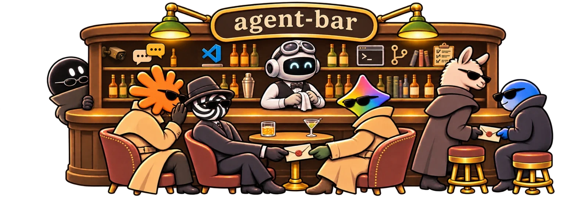
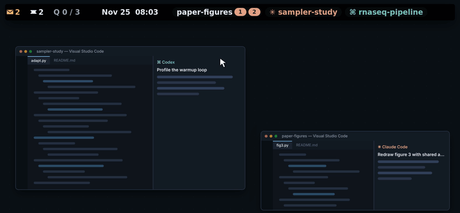
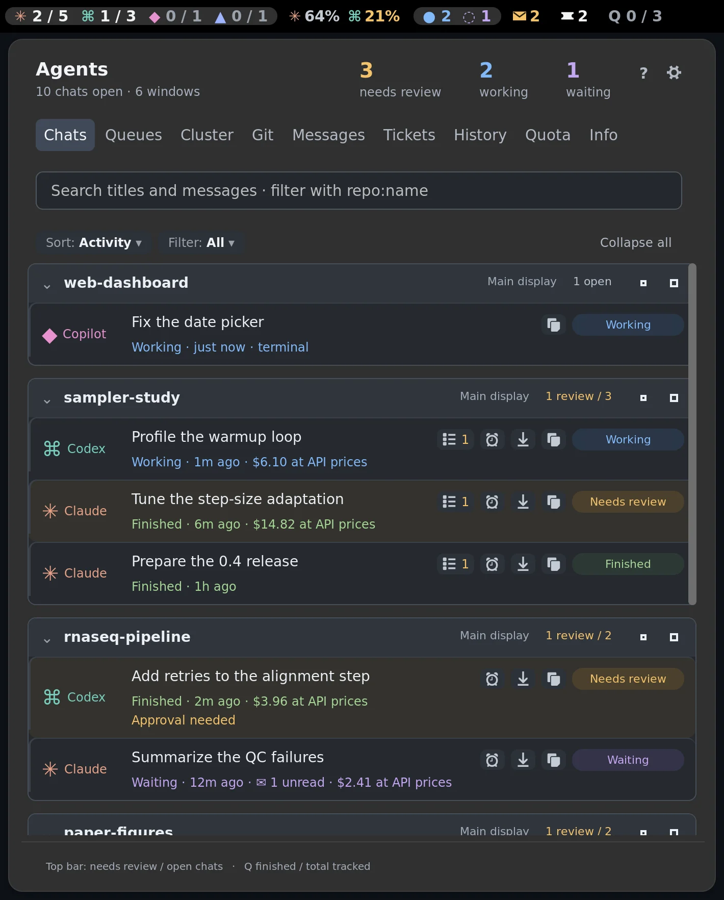
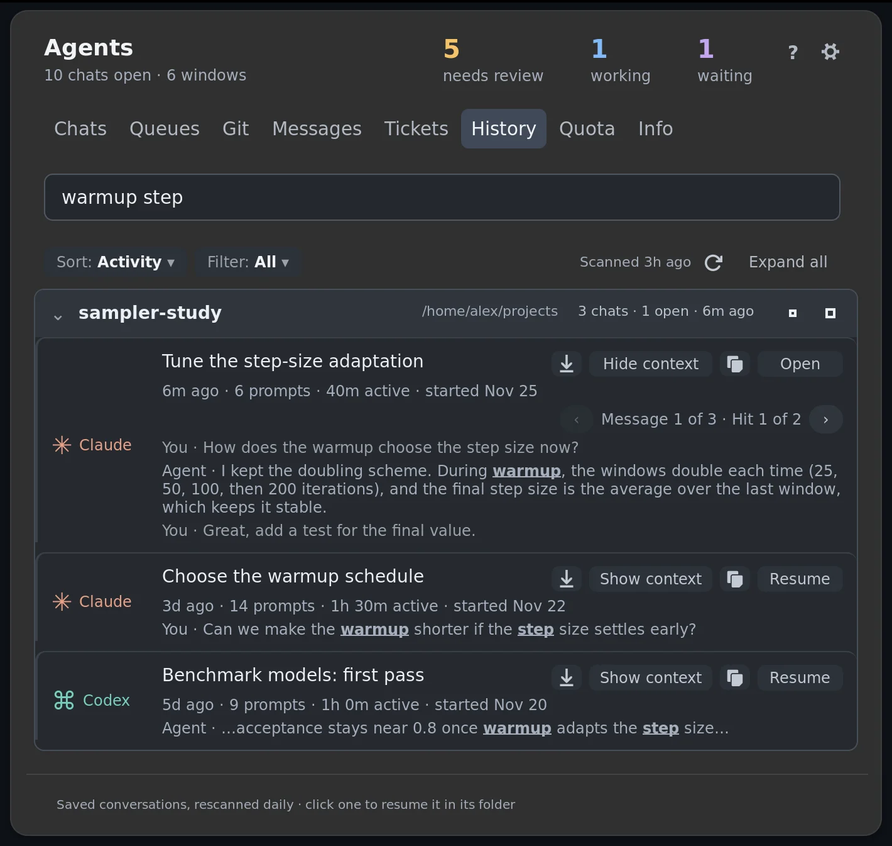
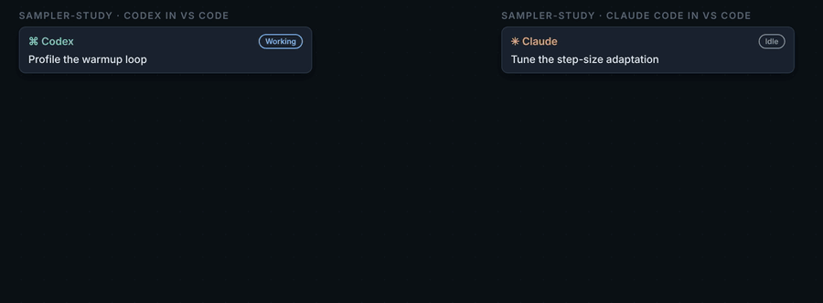

<p align="center"></p>

# Agent Bar

Agent Bar shows which coding agents are working, waiting or ready for review in the GNOME top bar. Click a chat to
bring its window, editor tab or sidebar forward. It tracks the chats you already use in VS Code, terminals and
desktop apps. Optional integrations add GitHub pull requests, Claude quota checks and ROTA job queues.

<p align="center"></p>

## A tour

The screenshots show made-up projects.

**The top bar.** See how many chats need review, how many are open, and how much weekly quota remains for each provider.
Project buttons take you to chats needing attention. Other indicators show working and waiting chats, unread messages,
ready tickets and queue progress.

<p></p>
<p></p>

**Chats and History.** Every open chat by project and window, with its state, why it needs review, and its cost at API
prices. History searches every saved Claude Code and Codex conversation, with context around each hit, resume and
export.

<p> </p>
<p></p>

**Messages and tickets.** Send notes between chats or schedule a message for later. Create a project ticket for work that
can start at a given time, after a usage limit resets or when the project’s queues finish.

<p></p>
<p> </p>

**Quota, Git and Info.** Each provider's 5-hour, weekly and per-model limits, the pace, and when you would run out
compared with the reset, plus cost at API prices. Uncommitted and unpushed work in every open repository, with a
diff summary and, optionally, each branch's pull request and checks. Each project's hooks, skills and instruction
files.

<p>  </p>

**Queues and Cluster** (with ROTA). Job queues per project, adjustable from the bar, and each host's CPU,
memory and disk.

<p> </p>

The [user guide](docs/guide.md) describes every part in detail.

## Supported agents

| | Claude Code | Codex | GitHub Copilot CLI | Antigravity |
| --- | --- | --- | --- | --- |
| Where | VS Code, terminal | VS Code (tabs and sidebar), terminal, ChatGPT desktop app | terminal | IDE, App, CLI (`agy`) |
| Status and review | yes | yes | yes | yes |
| Usage limits and cost | yes | yes | | |
| Messages and scheduled messages | yes; wakes idle chats | yes; wakes chats open in VS Code | | |
| History search, resume and export | yes | yes | | |

## Platforms

| Platform | Where it appears | Status |
| --- | --- | --- |
| Linux, GNOME Shell 42 (Ubuntu 22.04), X11 | the top bar | available |
| Linux, GNOME Shell 45 and later | the top bar | planned |
| macOS | the menu bar | planned |
| Windows | the system tray | planned |

## Install

You need Python 3.10 or later and [pipx](https://pipx.pypa.io) or [uv](https://docs.astral.sh/uv/). VS Code is needed
only for chats in VS Code.

```
pipx install git+https://github.com/NikVetr/agent-bar
agent-bar install
```

`agent-bar install` sets up, for your user only:

- a background service (`agent-bar.service`) and a daily inventory scan of saved chats;
- hooks in Claude Code's and Codex's settings, if you use them (your existing hooks are kept, and the old settings
  file is backed up first);
- the `agent-messages` skill, which tells Claude Code and Codex agents how to use messages and tickets, unless you
  already have a skill of that name;
- the VS Code bridge, a small extension that tells Agent Bar which chats each window has open;
- the menu-bar front end: on Linux, the GNOME Shell extension. The first time, log out and back in (or on X11 press
  Alt+F2, type `r`, press Enter) so GNOME finds it, then run `agent-bar install` again to enable it.

Open VS Code windows start the bridge on their own; after an update, reload each one (Developer: Reload Window) to
run the new version. Codex asks you to review new hooks once with `/hooks`.

`agent-bar doctor` checks each part and says how to fix anything missing. `agent-bar uninstall` takes it all out
again, leaving your history and settings (`--purge` deletes those too).

## Documentation

- [User guide](docs/guide.md): the top bar, every tab, messages, tickets, scheduled messages, task checklists, the
  scheduler integration, the command line and troubleshooting.
- [How Agent Bar compares](docs/comparison.md): related projects, what each offers, and where Agent Bar fits.
- [Architecture](docs/architecture.md): how the service, hooks, VS Code bridge and menu-bar front end fit together.

## Privacy

Agent Bar stores state in `~/.local/state/agent-bar` and settings in `~/.config/agent-bar`. The local History index
contains user and agent messages. It excludes tool calls, tool results, reasoning and client context. Hooks record
turn events without message text.

Two settings enable network requests:

- **Read Claude limits** checks the usage endpoint on `api.anthropic.com` every 10 minutes using Claude Code’s token from
  `~/.claude/.credentials.json`. Claude Code handles token renewal.
- **Pull requests** uses your signed-in `gh` command to read GitHub reviews and checks at most once every five
  minutes per branch.

## Development

```
git clone https://github.com/NikVetr/agent-bar && cd agent-bar
pipx install --editable .
python3 -m unittest discover tests
node --test tests/panel.test.js
```

## License

GPL-2.0-or-later. See [LICENSE](LICENSE).

<p align="center"></p>
