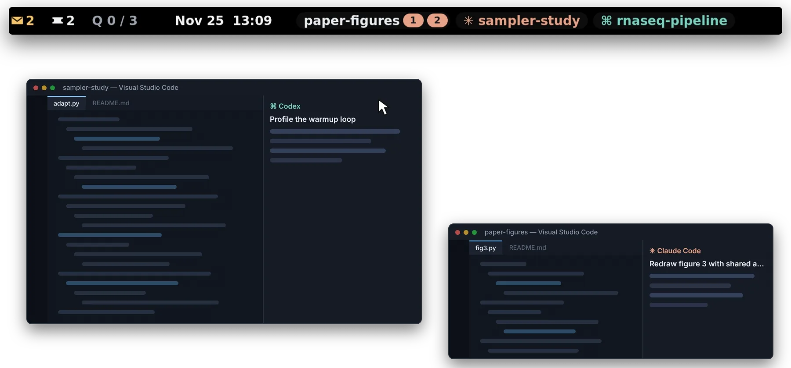
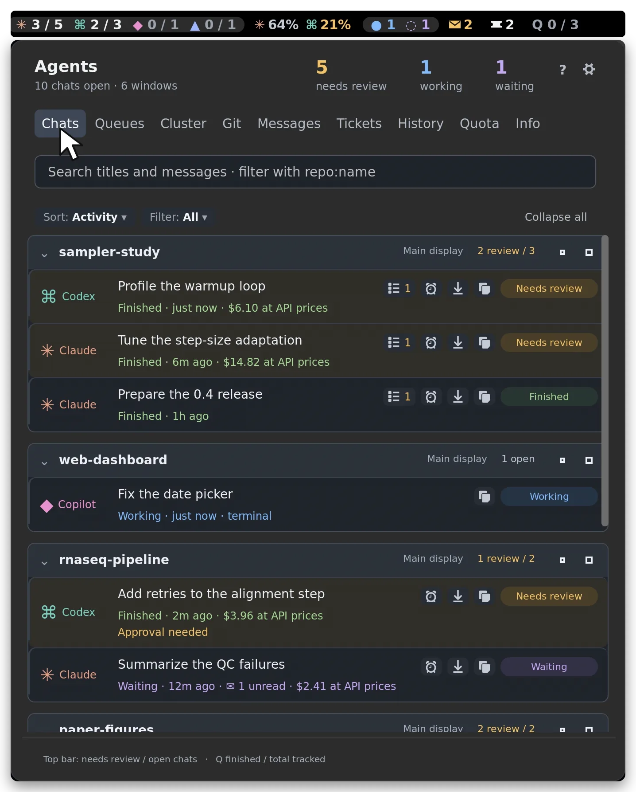
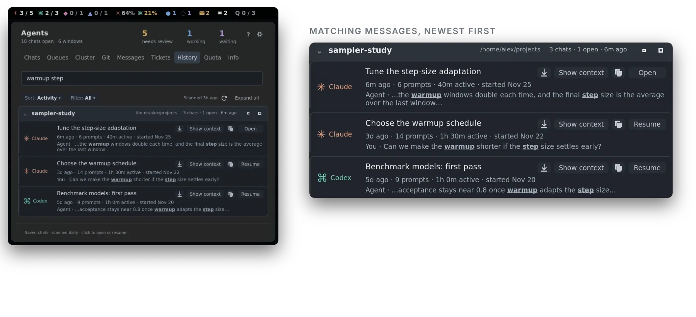
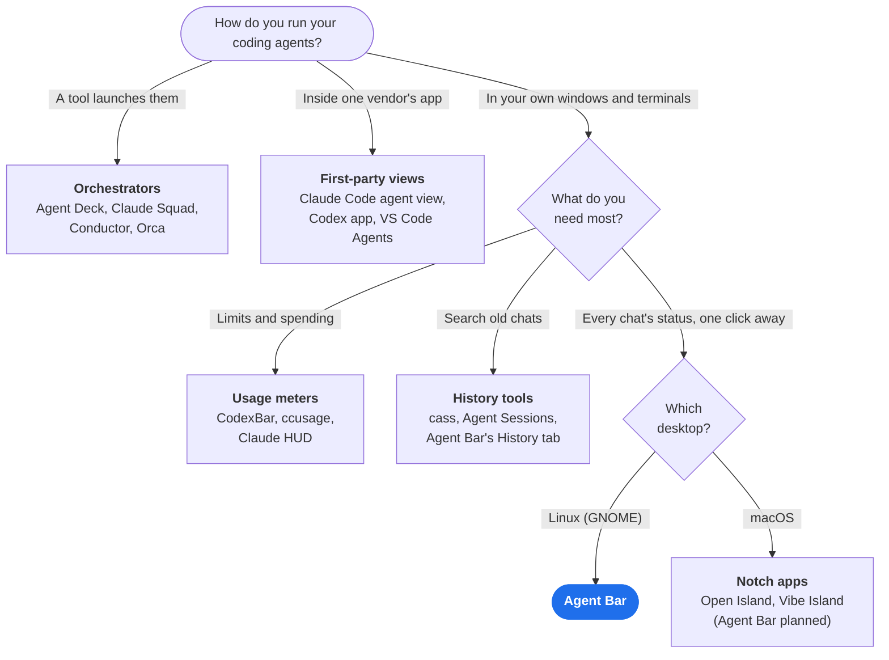

<p align="center"></p>

# Agent Bar

If you have a Claude chat open in one VS Code window and Codex working in another, which one just finished?
Agent Bar puts the answer in the GNOME top bar, with a macOS menu bar version planned. Click a project's button in the bar to go straight to the chat, even when it shares a
window with several others. It also follows agents in terminals and desktop apps. You can add GitHub pull requests,
Claude quota checks, and [ROTA](docs/guide.md#the-rota-job-scheduler-optional) job queues to the same bar.

<p align="center"><picture>
  <source media="(prefers-color-scheme: dark)" srcset="docs/images/click-to-chat-dark.webp">
  
</picture></p>

## Overview

**The top bar.** Read each provider’s count as *chats needing review / chats open*. Beside it you can see how much
weekly quota remains. You can also see how many chats are working, waiting, or need a prompt to read their mail,
how many tickets are ready, and how many queues have finished. Project buttons take you to chats that need review.

<p></p>
<p></p>

**The dropdown.** Clicking a part of the bar opens the dropdown on its tab:

- **Chats** groups open conversations by project and window, with what each agent is doing, why it needs review, and
  its estimated cost at API prices.
- **Queues** and **Cluster**, if you run jobs with ROTA, show each project's queues, which you can adjust from the bar,
  and how busy each host is.
- **Git** shows what you've changed locally, what you still need to push, and (if you enable it) each branch's pull
  request and checks.
- **Messages** and **Tickets** hold the notes chats leave each other and work saved for later.
- **History** holds every saved Claude Code and Codex chat, closed ones included. You can resume one in VS Code or export
  its messages.
- **Quota** shows the five-hour, weekly, and model-specific limits each provider reports, whether you're on course to
  run out before the reset, and what your usage would cost at API prices.
- **Info** lists the hooks, skills, and instruction files for each project.

<p align="center"><picture>
  <source media="(prefers-color-scheme: dark)" srcset="docs/images/tabs-dark.webp">
  
</picture></p>

**Search.** Remember what you discussed but not which chat it was in? Search History for words you or the agent
wrote. **Show context** opens the conversation around a match. Use the arrows to read the next one.

<p align="center"><picture>
  <source media="(prefers-color-scheme: dark)" srcset="docs/images/history-search-dark.webp">
  
</picture></p>

**Messages and tickets.** Claude and Codex chats can leave each other notes, even across projects. You can also schedule
a message yourself, or write a ticket for work that has to wait for a quota reset, a project’s queues, or a particular time.

<p align="center"><picture>
  <source media="(prefers-color-scheme: dark)" srcset="docs/images/agent-messages-dark.webp">
  
</picture></p>

The [user guide](docs/guide.md) describes every part in detail.

## Supported agents

| | Claude Code | Codex | GitHub Copilot CLI | Antigravity |
| --- | --- | --- | --- | --- |
| Where | VS Code, terminal | VS Code (tabs and sidebar), terminal, ChatGPT desktop app | terminal | IDE, desktop app, CLI (`agy`) |
| Status and review | yes | yes | yes | yes |
| Usage limits and cost | yes | yes | | |
| Messages and scheduled messages | yes; can wake idle chats (opt-in) | yes; can wake chats open in VS Code (opt-in) | | |
| History search, resume in VS Code, and export | yes | yes | | |

## Where it fits



[How Agent Bar compares](docs/comparison.md) has the feature table and the projects behind each box.

## Platforms

| Platform | Where it appears | Status |
| --- | --- | --- |
| Linux, GNOME Shell 42 (Ubuntu 22.04), X11 | the top bar | available |
| Linux, GNOME Shell 43 and later | the top bar | planned |
| macOS | the menu bar | planned |
| Windows | the system tray | planned |

## Install

You’ll need Python 3.10 or later and either [pipx](https://pipx.pypa.io) or [uv](https://docs.astral.sh/uv/).
VS Code is optional: without it, the installer skips the bridge, and chats in terminals and desktop apps are still
tracked.

```
pipx install git+https://github.com/NikVetr/agent-bar   # or: uv tool install git+https://github.com/NikVetr/agent-bar
agent-bar install
```

The installer sets these up for your user account:

- A background service (`agent-bar.service`) and a daily scan of saved chats.
- Hooks for Claude Code and Codex, if you use them. The installer backs up the settings file and keeps your existing hooks.
- The `agent-messages` skill, which teaches agents to use messages and tickets. An existing skill of the same name takes precedence.
- A small VS Code extension (the bridge) that reports which chats each window has open.
- The GNOME Shell extension that draws the top bar and dropdown.

On the first install, log out and back in so GNOME finds the extension (on X11 you can also press Alt+F2, type `r`,
and press Enter). Run `agent-bar install` again to enable it. Open VS Code windows start the bridge on their own.
After an update, use **Developer: Reload Window** in each one to pick up the new bridge. Codex asks you to review
new hooks once: run `/hooks` in Codex and accept Agent Bar's.

If something is missing, `agent-bar doctor` will tell you which part and suggest a fix. To remove Agent Bar, run
`agent-bar uninstall`. This keeps your settings and history unless you add `--purge`.

## Documentation

- [User guide](docs/guide.md): the top bar, every tab, messages, tickets, scheduled messages, task checklists, the
  scheduler integration, the command line, and troubleshooting.
- [How Agent Bar compares](docs/comparison.md): related projects, what each offers, and where Agent Bar fits.
- [Architecture](docs/architecture.md): how the service, hooks, VS Code bridge, and GNOME Shell extension fit together.

## Privacy

The History index contains the words you and the agents wrote. It leaves out tool calls and results, reasoning,
and client context. Hooks record turn events (starts, finishes, questions, approvals, and failures) without what
you or the agent wrote. State lives in
`~/.local/state/agent-bar`, settings in `~/.config/agent-bar`, and the VS Code bridge build in `~/.cache/agent-bar`.

Two optional settings contact a service outside your machine:

- **Read Claude limits** checks `api.anthropic.com` every 10 minutes, using Claude Code’s token from
  `~/.claude/.credentials.json`. Claude Code handles token renewal.
- **Pull requests** uses your signed-in `gh` command to read pull request reviews and check results at most once every 5
  minutes per branch.

## Development

```
git clone https://github.com/NikVetr/agent-bar && cd agent-bar
pipx install --editable .
python3 -m unittest discover tests
node --test tests/panel.test.js
```

## License

GPL-2.0-or-later. See [LICENSE](LICENSE).

<p align="center"></p>
