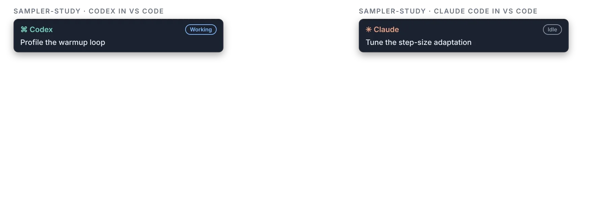
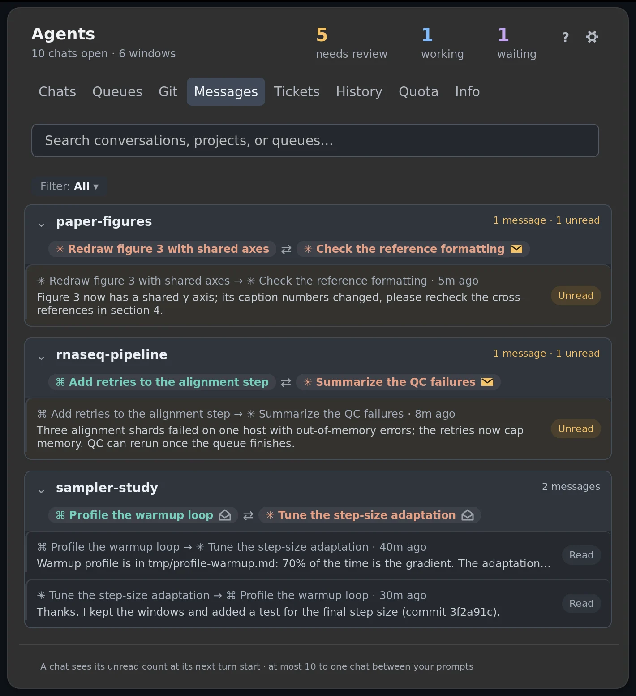
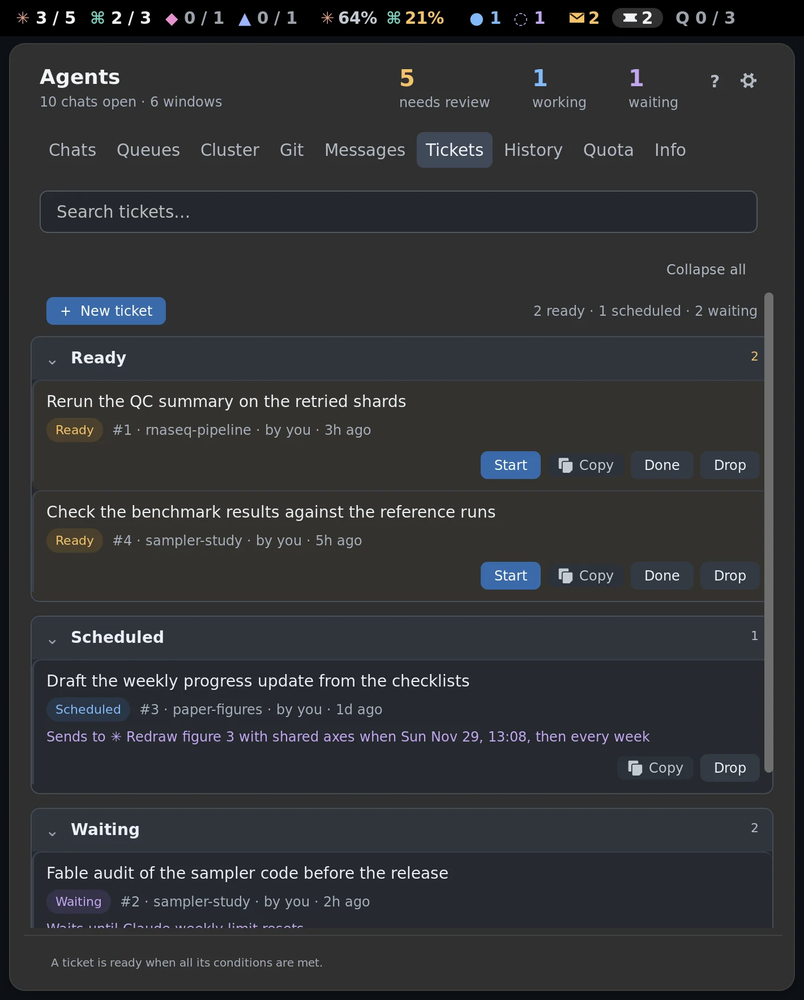
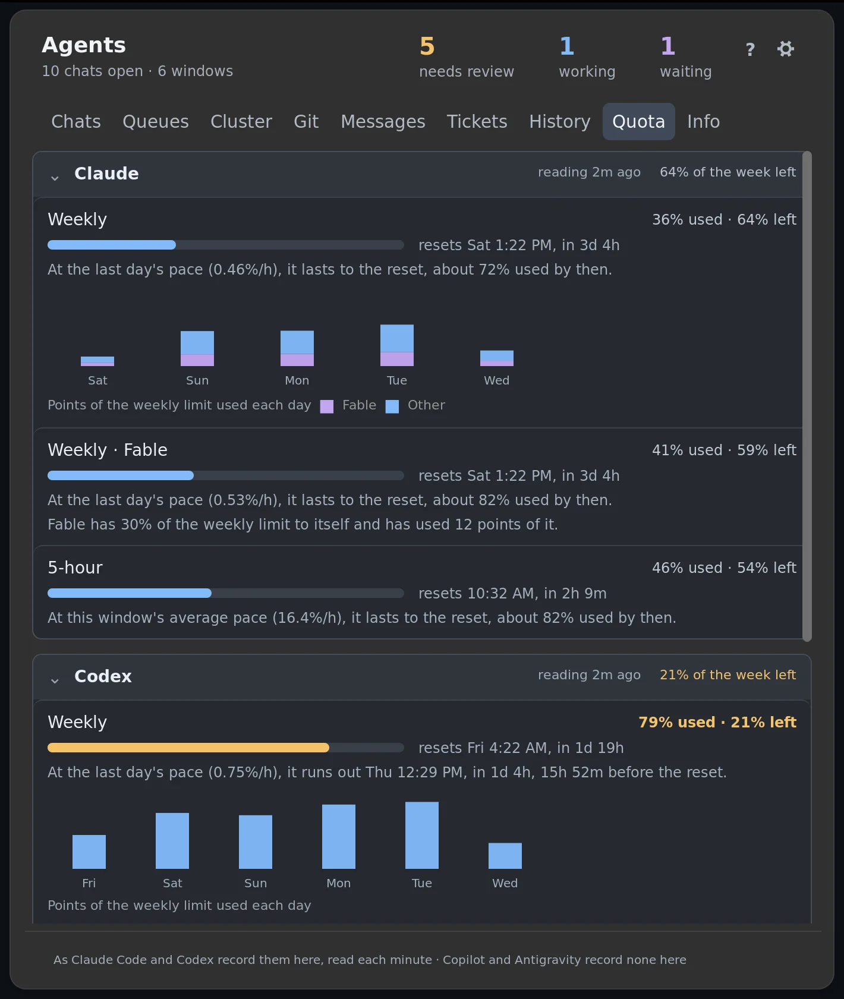
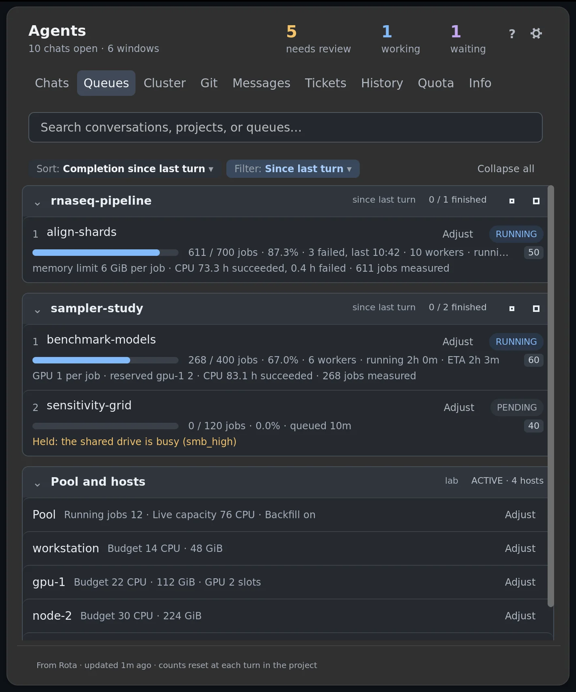
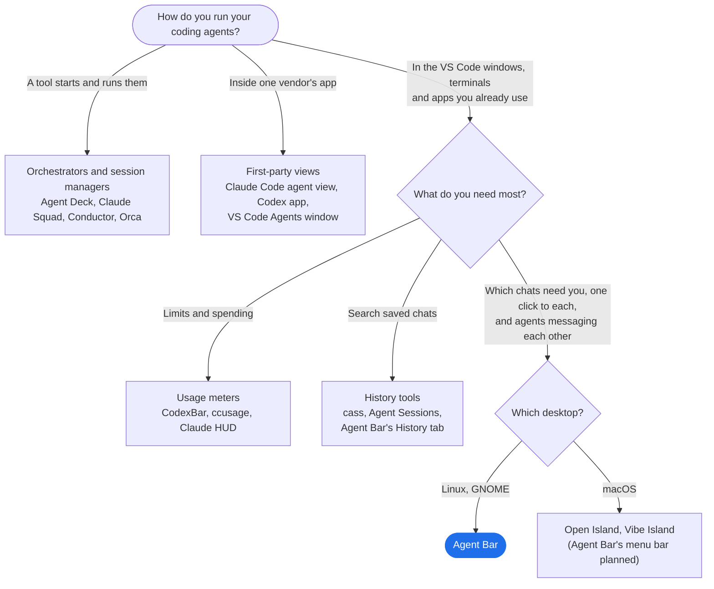

<p align="center"></p>

# Agent Bar

If you have a Claude chat open in one VS Code window and Codex working in another, which one just finished?
Agent Bar puts the answer in the GNOME top bar, with a macOS menu bar version planned. Click the project to go straight to the chat, even when it shares a
window with several others. It also follows agents in terminals and desktop apps. You can add GitHub pull requests,
Claude quota checks, and ROTA job queues to the same bar.

<p align="center"><picture>
  <source media="(prefers-color-scheme: dark)" srcset="docs/images/click-to-chat-dark.webp">
  
</picture></p>

## Overview

**The top bar.** Read each provider’s count as *chats needing review / chats open*. Beside it you can see how much
weekly quota remains. You can also see how many chats are working, waiting, or need a prompt to read their mail,
how many tickets are ready, and how many queues have finished. Project buttons take you to chats that need review.

<p></p>
<p></p>

**Chats and History.** Chats groups open conversations by project and window. Each row tells you what the agent
is doing, why it needs review, and its estimated cost at API prices where available. History also includes saved
Claude Code and Codex chats you’ve closed. You can resume one or export its messages.

<p> </p>

Remember what you discussed but not which chat it was in? Search for words you or the agent wrote.
**Show context** opens the conversation around a match. Use the arrows to read the next one.

<p align="center"><picture>
  <source media="(prefers-color-scheme: dark)" srcset="docs/images/history-search-dark.webp">
  
</picture></p>

**Messages and tickets.** Claude and Codex chats can leave each other notes, even across projects. You can also schedule
a message yourself, or write a ticket for work that has to wait for a quota reset, a project’s queues, or a particular time.

<p align="center"><picture>
  <source media="(prefers-color-scheme: dark)" srcset="docs/images/agent-messages-dark.webp">
  
</picture></p>
<p> </p>

**Quota, Git, and Info.** Quota shows the five-hour, weekly, and model-specific limits each provider reports.
The forecast tells you whether you’re on course to run out before the reset. You can also see what your usage would
cost at API prices. Git shows what you’ve changed locally, what you still need to push, and (if you enable it) the
branch’s pull request and checks. Info lists the hooks, skills, and instruction files for each project.

<p>  </p>

**Queues and Cluster.** If you run jobs with ROTA, you can check or adjust a project’s queues from the top bar.
Open Cluster to see how busy each host is and how much memory and disk space it has left.

<p> </p>

The [user guide](docs/guide.md) describes every part in detail.

## Supported agents

| | Claude Code | Codex | GitHub Copilot CLI | Antigravity |
| --- | --- | --- | --- | --- |
| Where | VS Code, terminal | VS Code (tabs and sidebar), terminal, ChatGPT desktop app | terminal | IDE, App, CLI (`agy`) |
| Status and review | yes | yes | yes | yes |
| Usage limits and cost | yes | yes | | |
| Messages and scheduled messages | yes; can wake idle chats (opt-in) | yes; can wake chats open in VS Code (opt-in) | | |
| History search, resume, and export | yes | yes | | |

## Where it fits



[How Agent Bar compares](docs/comparison.md) has the feature table and the projects behind each box.

## Platforms

| Platform | Where it appears | Status |
| --- | --- | --- |
| Linux, GNOME Shell 42 (Ubuntu 22.04), X11 | the top bar | available |
| Linux, GNOME Shell 45 and later | the top bar | planned |
| macOS | the menu bar | planned |
| Windows | the system tray | planned |

## Install

You’ll need Python 3.10 or later and either [pipx](https://pipx.pypa.io) or [uv](https://docs.astral.sh/uv/).
If your agents run in terminals, you can leave VS Code out of the installation.

```
pipx install git+https://github.com/NikVetr/agent-bar
agent-bar install
```

The installer sets these up for your user account:

- A background service (`agent-bar.service`) and a daily scan of saved chats.
- Hooks for Claude Code and Codex, if you use them. The installer backs up the settings file and keeps your existing hooks.
- The `agent-messages` skill, which teaches agents to use messages and tickets. An existing skill of the same name takes precedence.
- A small VS Code extension (the bridge) that reports which chats each window has open.
- The GNOME Shell extension that draws the top bar and dropdown.

On the first install, log out and back in so GNOME finds the extension (on X11 you can also press Alt+F2, type `r`,
and press Enter). Run `agent-bar install` again to enable it. Open VS Code windows start the bridge on their own.
After an update, use **Developer: Reload Window** in each one to pick up the new bridge. Codex asks you to review
new hooks once with `/hooks`.

If something is missing, `agent-bar doctor` will tell you which part and suggest a fix. To remove Agent Bar, run
`agent-bar uninstall`. This keeps your settings and history unless you add `--purge`.

## Documentation

- [User guide](docs/guide.md): the top bar, every tab, messages, tickets, scheduled messages, task checklists, the
  scheduler integration, the command line, and troubleshooting.
- [How Agent Bar compares](docs/comparison.md): related projects, what each offers, and where Agent Bar fits.
- [Architecture](docs/architecture.md): how the service, hooks, VS Code bridge, and menu-bar front end fit together.

## Privacy

The History index contains the words you and the agents wrote. It leaves out tool calls and results, reasoning,
and client context. Hooks record turn events (starts, finishes, questions, approvals, failures) without what
you or the agent wrote. State lives in
`~/.local/state/agent-bar`, settings in `~/.config/agent-bar`, and the VS Code bridge build in `~/.cache/agent-bar`.

Two optional settings contact a service outside your machine:

- **Read Claude limits** checks `api.anthropic.com` every 10 minutes, using Claude Code’s token from
  `~/.claude/.credentials.json`. Claude Code handles token renewal.
- **Pull requests** uses your signed-in `gh` command to read pull request reviews and check results at most once every five
  minutes per branch.

## Development

```
git clone https://github.com/NikVetr/agent-bar && cd agent-bar
pipx install --editable .
python3 -m unittest discover tests
node --test tests/panel.test.js
```

## License

GPL-2.0-or-later. See [LICENSE](LICENSE).

<p align="center"></p>
