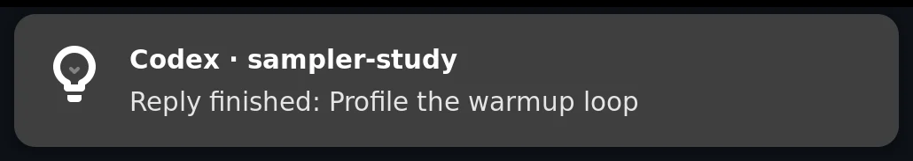
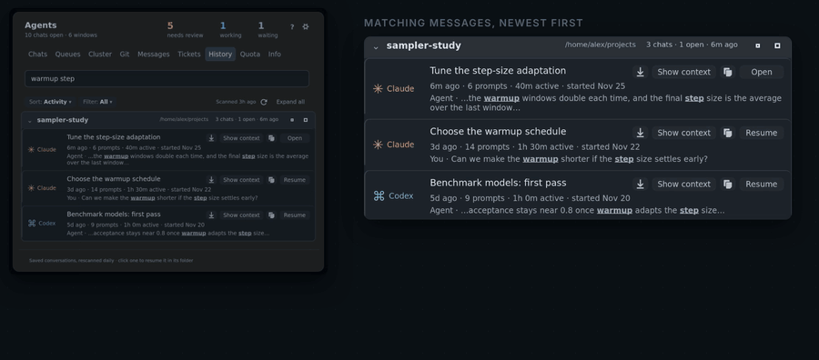
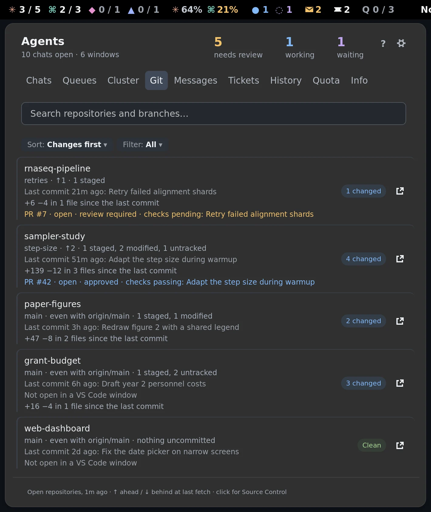
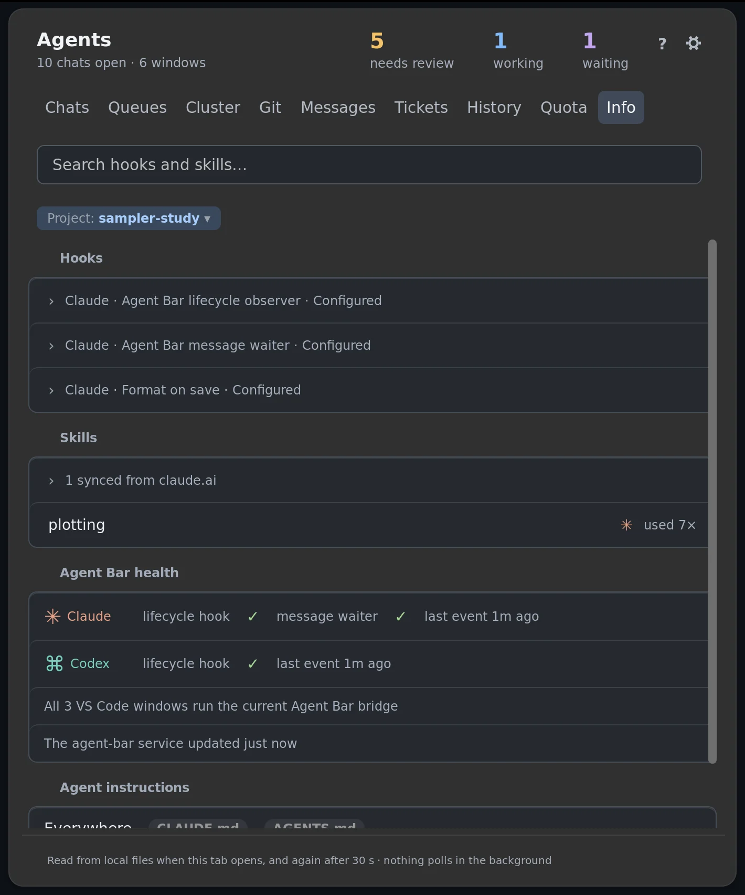
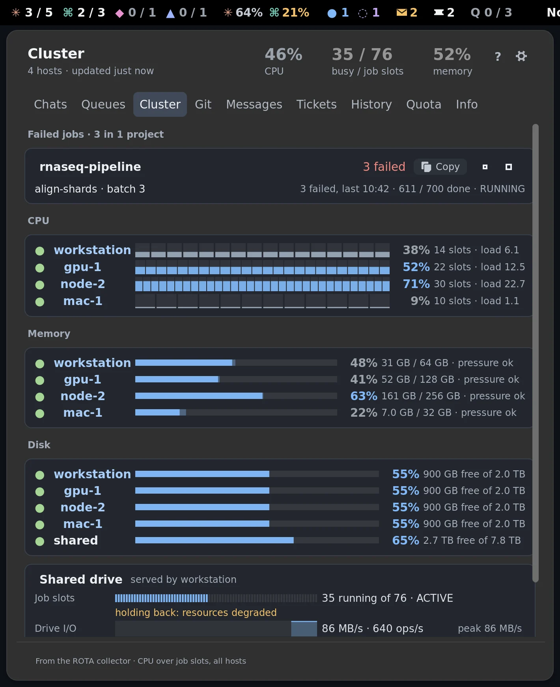

<p align="center"></p>

# Agent Bar

Agent Bar puts your open AI coding agent chats in your desktop's menu bar. You can see at a glance which ones have
finished and need your review, which are still working, and which are waiting on you, and one click brings a chat's
window forward. It also shows your projects' git status and usage limits, lets agents in different chats leave each
other notes and tickets for later, and can follow job queues from the optional ROTA job scheduler.

It reads only local files that the agent tools already write, plus small hooks that record when a turn starts and
ends. Nothing leaves your computer unless you turn on reading Claude's usage limits (see [Privacy](#privacy)).

<p align="center"></p>

## Highlights

- **Works with the agents where you already run them.** Claude Code, Codex, GitHub Copilot CLI and Antigravity, in
  VS Code, the terminal and their desktop apps. Agent Bar watches the chats you open; it does not start, wrap or
  host agents, so you keep each tool's own interface, settings and sign-in.
- **One glance, one click.** Counts per provider of chats needing review, working and waiting, a button for each chat
  that needs you, and a desktop notification as each one comes to need you. A click brings the exact VS Code tab or
  sidebar chat forward, maximized, and a second click sends it back.
- **Usage limits and cost.** Claude and Codex 5-hour, weekly and per-model limits, the pace of use, and when that
  pace would run out compared with the reset. What your use would cost at API prices, per day, per model and per
  chat, counted from the agents' own token records. A setting lets Codex chats in VS Code that a five-hour limit
  stopped continue on their own when it resets.
- **Agents that coordinate.** Agents in different chats, projects and providers can message each other, and idle
  chats can be woken to read them. Tickets hold work for later, until a usage limit resets, job queues finish, a time
  comes, or another ticket closes. Messages can be scheduled to a chat, once or on repeat.
- **Your history, searchable.** Full-text search over saved Claude and Codex conversations, by project or across all
  of them, with context around each hit, one-click resume, and export to HTML or Markdown.
- **Local and inspectable.** Everything runs on your computer from files the agent tools already write. Every view is
  also available as JSON from the `agent-bar` command line.

Most multi-agent tools launch agents inside their own terminal or app, or cover one provider. Agent Bar observes the
chats you already have open, across providers. [How Agent Bar compares](docs/comparison.md) surveys related projects,
what each offers, and where Agent Bar fits.

## A tour

The screenshots show made-up projects.

**The top bar.** Chats needing review / open per provider, weekly limit left, working and waiting counts, agent mail,
tickets that came due, queue progress, and a button for each chat that needs you. A notification announces each chat
as it comes to need you.

<p></p>
<p></p>

**Chats and History.** Every open chat by project and window, with its state, why it needs review, and its cost at API
prices. History searches every saved Claude Code and Codex conversation, with context around each hit, resume and
export.

<p> </p>
<p></p>

**Messages and tickets.** Agents in different chats leave each other notes, or tickets for work to do later, waiting
for a usage limit to reset, queues to finish, or a time. Messages can also be scheduled to a chat.

<p></p>
<p> </p>

**Quota, Git and Info.** Each provider's 5-hour, weekly and per-model limits, the pace, and when you would run out
compared with the reset, plus cost at API prices. Uncommitted and unpushed work in every open repository, with a
diff summary and, optionally, each branch's pull request and checks. Each project's hooks, skills and instruction
files.

<p>  </p>

**Queues and Cluster** (with ROTA). Job queues per project, adjustable from the bar, and each host's CPU,
memory and disk.

<p> </p>

The [user guide](docs/guide.md) describes every part in detail.

## Supported agents

| | Claude Code | Codex | GitHub Copilot CLI | Antigravity |
| --- | --- | --- | --- | --- |
| Where | VS Code, terminal | VS Code (tabs and sidebar), terminal, ChatGPT desktop app | terminal | IDE, App, CLI (`agy`) |
| Status and review | yes | yes | yes | yes |
| Usage limits and cost | yes | yes | | |
| Messages and scheduled messages | yes; wakes idle chats | yes; wakes chats open in VS Code | | |
| History search, resume and export | yes | yes | | |

## Platforms

| Platform | Where it appears | Status |
| --- | --- | --- |
| Linux, GNOME Shell 42 (Ubuntu 22.04), X11 | the top bar | available |
| Linux, GNOME Shell 45 and later | the top bar | planned |
| macOS | the menu bar | planned |
| Windows | the system tray | planned |

The service, command line, hooks and VS Code bridge are shared by every platform; each platform has its own small
menu-bar front end.

## Install

You need Python 3.10 or later and [pipx](https://pipx.pypa.io) or [uv](https://docs.astral.sh/uv/). VS Code is needed
only for chats in VS Code.

```
pipx install git+https://github.com/NikVetr/agent-bar
agent-bar install
```

`agent-bar install` sets up, for your user only:

- a background service (`agent-bar.service`) and a daily inventory scan of saved chats;
- hooks in Claude Code's and Codex's settings, if you use them (your existing hooks are kept, and the old settings
  file is backed up first);
- the `agent-messages` skill, which tells Claude Code and Codex agents how to use messages and tickets, unless you
  already have a skill of that name;
- the VS Code bridge, a small extension that tells Agent Bar which chats each window has open;
- the menu-bar front end: on Linux, the GNOME Shell extension. The first time, log out and back in (or on X11 press
  Alt+F2, type `r`, press Enter) so GNOME finds it, then run `agent-bar install` again to enable it.

Open VS Code windows start the bridge on their own; after an update, reload each one (Developer: Reload Window) to
run the new version. Codex asks you to review new hooks once with `/hooks`.

`agent-bar doctor` checks each part and says how to fix anything missing. `agent-bar uninstall` takes it all out
again, leaving your history and settings (`--purge` deletes those too).

## Documentation

- [User guide](docs/guide.md): the top bar, every tab, messages, tickets, scheduled messages, task checklists, the
  scheduler integration, the command line and troubleshooting.
- [How Agent Bar compares](docs/comparison.md): related projects, what each offers, and where Agent Bar fits.
- [Architecture](docs/architecture.md): how the service, hooks, VS Code bridge and menu-bar front end fit together.

## Privacy

On Linux, Agent Bar keeps its state in `~/.local/state/agent-bar` and its settings in `~/.config/agent-bar`, readable
only by you. The History scan stores searchable message text in a local SQLite index. It skips tool calls, tool
results, reasoning, and client-supplied context. Its hooks record when turns start and end, never prompt or reply
text. It contacts no server, unless you turn on **Read Claude limits**: then every 10 minutes it asks Anthropic's
usage endpoint (`api.anthropic.com`, the one Claude Code's `/usage` reads, which is undocumented) for your limits,
sending Claude Code's sign-in token from `~/.claude/.credentials.json`. It never renews or changes that sign-in; when
it has expired, Agent Bar waits for Claude Code to renew it. With **Pull requests** on, the Git tab asks GitHub about
each open branch's pull request through the `gh` command, at most every 5 minutes per branch.

## Development

```
git clone https://github.com/NikVetr/agent-bar && cd agent-bar
pipx install --editable .
python3 -m unittest discover tests
node --test tests/panel.test.js
```

[docs/architecture.md](docs/architecture.md) describes how the parts fit together.

## License

GPL-2.0-or-later. See [LICENSE](LICENSE).

<p align="center"></p>
