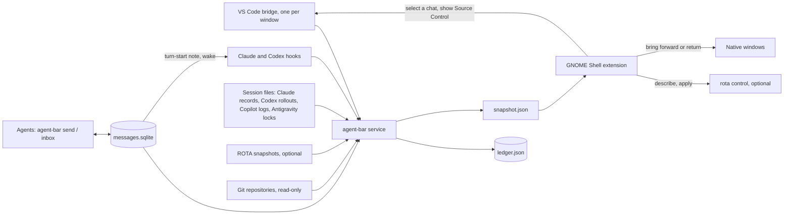

# Architecture

The service turns evidence from hooks, open windows and session files into a snapshot the GNOME panel can read.
The Python service and CLI, provider hooks, VS Code bridge and panel share owner-only state in
`~/.local/state/agent-bar`. Process discovery depends on Linux, and native window lookup depends on X11.

## Service and CLI

The `agent-bar.service` user unit runs `agent-bar serve`. It collects state every three seconds and writes
`snapshot.json` when something changes, or every ten seconds if nothing has. The panel reads the snapshot
asynchronously. Commands that act on live chats talk to the service over a Unix socket using JSON; the rest read state files
directly. A chat’s provider, turn state and
reasons for review are separate fields, as is the state of its project’s queues.

- **VS Code:** each window's bridge publishes its folders, open tabs, provider versions and a heartbeat. Codex's
  per-window view-activity log establishes open sidebar conversations, and its custom-editor URIs identify editor
  ones. The collector saves those IDs per live bridge and reads the final events from a rotated log.
  If the original view event has rotated away, a turn submitted from that window can recover its conversation ID.
  For a recovered ID, or when several Codex IDs have no matching tab in one window, the bridge opens the requested ID in a Codex
  editor and verifies the active tab's URI. Claude's saved panel-session IDs are matched against live tab labels,
  with ambiguous matches rejected.
- **Terminals and apps** (`providers.py`). The collector associates each session with the process whose native
  window can bring it forward. The evidence differs by provider:
  - Claude Code CLI records a PID in `~/.claude/sessions/<pid>.json`. The collector checks the process start time.
  - For Codex CLI and the desktop app, it looks for rollout files held open by a `codex` process outside VS Code.
  - For Copilot CLI, it finds the live process’s foreground session in `process-<ms>-<pid>.log`, then reads that
    session’s `workspace.yaml` and `events.jsonl`.
  - An Antigravity IDE, App or CLI process holds a `presence/<id>.lock` file for its conversation.
    `conversation_summaries.db` supplies the title, folder and run status.
- **Turns.** Each provider hook writes a small file per lifecycle event. The collector also reads bounded tails
  of open Codex rollouts and Copilot event logs. For an open Claude chat it checks the transcript for background
  work, scheduled wake-ups and the source of the last prompt. If an automatic wake-up produces a reply while work
  is still pending, the chat stays in Waiting. A turn that read agent messages can still bring it up for review.
- **Ledger** (`state.py`). For each chat the ledger keeps its state, unread reasons and acknowledgment cutoff. For
  each folder name it keeps the last turn start, and for each queue, when the tracker first saw it finish.
  A project counts every unfinished queue plus those that finished since its last turn, using the earlier of
  the monitor’s end time and the tracker’s observation. When the last queue finishes, the most recently active
  open chat in that project gets a “Queues finished” review. If the monitor reports a finished queue as active
  again, it stays finished unless workers are running or its job counts change.

  Hourly cleanup drops a finished queue after a week if it has fallen out of both the counts and the monitor.
  It also removes closed chats idle for 30 days and files left by closed windows.

  A usage-limit stop marks a chat `limited` until its next turn. Claude reports `StopFailure` with `rate_limit`
  and gives the reset time in the transcript’s closing API error. Codex reports `task_complete` with
  `usage_limit_exceeded`. For Codex, the collector pairs that event with quota readings from the same thread and turn.
  If only the five-hour window is exhausted, it saves the reset time. With **Resume Codex after reset** on, the service
  can then queue a continuation by thread ID once the reset has passed and the chat is open in VS Code. Manual
  and scheduled continuations share a durable delivery record. If delivery stops with its outcome unknown, the
  user can retry with **Continue**.

- **Inventory** (`inventory.py`): every saved Claude and Codex chat, rescanned daily at idle priority, reading only
  appended transcript data. The same pass indexes direct message text in `history-search.sqlite` using SQLite FTS5.
  The search index and inventory track the file identity and byte offset. Replacing or truncating a transcript rebuilds
  its entries. Chats and History share a query and hit cache. Message searches run through the CLI after a short typing delay
  and return one excerpt per matching conversation. Expanding a hit queries that conversation for a bounded passage around the selected occurrence
  and nearby dialogue. The panel loads one passage at a time and keeps its position while the search is open.
- **Export** (`export.py`): `agent-bar export` reads a conversation's transcript files directly (a Codex thread and
  its continuation files, oldest first) with the same message filter as the History index, keeping each message's
  time, and writes Markdown or self-contained HTML. Output goes to the XDG Downloads folder unless `--output` names a
  file or folder, and never replaces an existing file.
- **Git** (`git.py`). Outside the collection loop, Agent Bar reads `git status` for each open repository every
  20 seconds while the Git tab is active and every five minutes otherwise. It sets `GIT_OPTIONAL_LOCKS=0` so
  an agent working in the repository can take the index lock. It never fetches. For staged or modified files it
  also runs `git diff HEAD --numstat`. With **Pull requests** enabled, it runs `gh pr view <branch> --json …`
  and caches the result for five minutes per repository and branch. If `gh` is missing or fails, the repository
  row shows the error.
- **Usage** (`usage.py`). Once a minute, outside the collection loop, the service reads Claude Code’s cached
  `limits` in `~/.claude.json` (including model-specific weekly limits and shares) and the `rate_limits` in
  Codex rollouts. The first rollout scan covers 15 days. Each later scan reads from a saved byte offset.
  `usage-history.json` retains changed readings for 15 days. A reset time drifting by a few seconds still belongs
  to the same quota window.

  The forecast uses the reading in effect a day ago, or starts from zero at the beginning of the quota window.
  It estimates when the quota would run out and how much would be used by the reset. Weekly totals also show
  points used each local day, split by model where reported. The snapshot and `agent-bar usage` carry the same summary.

  With **Read Claude limits** enabled (off by default), the service also checks `GET https://api.anthropic.com/api/oauth/usage`
  every ten minutes, backing off for up to an hour after failures. This is the undocumented endpoint Claude Code’s
  `/usage` reads. Agent Bar uses Claude Code’s OAuth access token and leaves renewal to Claude Code. The response
  has the same shape as the local cache, so the service can use whichever reading is newer.

- **Costs** (`costs.py`): with each usage pass, the token counts in Claude transcripts (every `.jsonl` under
  `~/.claude/projects`, subagents included) and Codex `token_count` events, read from saved offsets like the usage
  pass, priced with `data/prices.json` merged with `~/.config/agent-bar/prices.json`. A Claude reply written once per
  content block counts once (message and request ID). A Codex response counts when its thread's running total moves,
  using that response's own tokens, so repeated readings and continuation files add nothing. Totals go to
  `costs.json` per local day, provider and model (15 days) and per chat; a change to the effective prices counts
  everything again. The snapshot carries the summary and the open chats' totals.
- **Checklists** (`checklists.py`): every 30 s, the task checklists in the open projects' `tmp/agent/checklists/`,
  parsed only when a file's size or modification time changes, with the open chats seen editing each (`Background`
  notes Claude's Edit/Write/writing Bash calls, `Providers.events` Codex's apply_patch and shell calls, both from the
  transcript tails they already read). The full result goes to `checklists.json` only when it changes; the snapshot
  carries per-folder counts for the panel's row buttons.
- **Info** (`info.py`): read only when the panel's Info tab asks: skills, hook registrations, tracker health, and instruction files.
  The hook inventory reads Claude settings and enabled installed plugin definitions for the selected folder and requests
  Codex’s effective hook list and trust states for that folder over the local app-server connection. The CLI returns
  each handler’s declared action and its event, matcher, and condition together for each trigger. Reading Info never
  executes a registered handler.

`agent-bar queue-dependencies` identifies a queue by pool, queue ID and batch directory. The service indexes
immutable declarations for all tracked queues, including retired queues, so filtering a project preserves links
to hidden dependents. It reads mutable prerequisite outcomes and verification markers only for requested rows, off
the collection loop, with a 30-second cache. Display numbers follow launch order within each project.

## Hooks

Claude Code and Codex run `python -m agent_bar.hook` on lifecycle events. It records the event kind, session,
time and folder, omits prompt and tool text, and never blocks a turn. Its only output is the unread-message note
(`additionalContext` on `UserPromptSubmit`).

Claude also runs `python -m agent_bar.hook wait` as a background Stop hook (`asyncRewake`, one-week timeout).
With waking enabled, it exits with status 2 once per new message, which tells Claude Code to wake the chat.

`agent-bar install` sets up both hooks. It copies the messaging skill from `agent_bar/data/skills` into
`~/.claude/skills` and `~/.agents/skills` where the name is available. The installer marks its own copies with
`.installed-by-agent-bar` so it knows which ones it can update or remove.

## Messages

The CLI reads and writes notes directly in `messages.sqlite` through `messages.py`. The sender’s identity comes
from `CLAUDE_CODE_SESSION_ID` or `CODEX_THREAD_ID`. The recipient must be an open Claude Code or Codex chat. The
loop guard counts messages from a sender to a recipient between human prompts to the sender. The user can reset
that limit. A separate cap counts all the sender’s messages in the past hour. `agent-bar raise-limit` raises that
cap to `RAISED_HOURLY` for one hour and records the change in the `raises` table.

A refused send records which limit it hit and when the sender can try again. The snapshot lists refusals and each
recent sender’s count against its own cap. The panel notifies once per new refusal.

Files under `wake/` keep track of which message a recipient still needs to hear about. They record its latest
unread ID, its latest unread urgent ID (`<key>.urgent`), the last ID that prompted a wake or notification, and the
PID of its live waiter. The user controls whether a busy Claude chat can receive a message mid-turn.

With waking enabled, `codex_wake.py` uses the local app-server queue API for recipients open in VS Code. It queues
one inbox notification and moves that ID ahead of any drafts, preserving their order.

If the queue changes during the reorder, it reads the IDs again and retries once. A per-chat lock serializes sends
and a `.queued` marker coalesces notifications until a turn starts. A busy chat with an empty queue receives a
`.deferred` marker so the service can queue its notification after the turn if messages are still unread.
If the queue API is unavailable, idle chats use the `codex queue` command and busy chats defer until turn end.
When a queued note's turn starts with nothing unread, the hook says the messages were already read; any
other turn start clears both markers, since that turn hears of unread messages itself. The snapshot's `messages.stranded` lists the open chats whose
unread messages wait for the user to start a turn: Codex chats with no note queued, and Claude chats no waiter will
wake (waking off, or idle with no live waiter left).

## Tickets

The panel calls the same CLI an agent uses. The CLI reads and writes `tickets.sqlite` through `tickets.py`.
`CLAUDE_CODE_SESSION_ID` or `CODEX_THREAD_ID`, when set, identifies the author. Otherwise it defaults to the user,
subject to the process check below.

Wait conditions are resolved when the ticket is written. For a quota reset, the service snapshot supplies the
time. For a project’s queues, the ledger supplies the outstanding IDs using the ticket folder’s `project_names`.
A wait can also name a time directly or refer to another ticket by number.

Readiness is calculated when tickets are listed. Dates are compared with the clock, queues with the ledger
(a queue pruned from the ledger finished long ago), and ticket numbers with the open tickets. The service refreshes
the listing in the snapshot when the database or queues change and every 30 seconds for time-based waits.
Closed tickets are pruned after 30 days. Their numbers stay retired so a prompt or `ticket:` wait can’t refer to a
different task later.

A ticket with `deliver_to` names a chat to receive its text. On each pass the service checks which tickets are
ready. Outside the collection loop, `tickets.deliver_due` sends them with `messages.send` under the author’s
identity. A successful send closes a one-off ticket. For a `repeat`, the next date is counted from the original
`anchor`. After a gap, one overdue copy goes out and the schedule advances past the other missed deliveries.
Failures stay on the ticket (`delivery_error`, `tried_at`) for a retry after ten minutes.

Only scheduled delivery can send as `user`. Those messages bypass the loop guard, and both the turn-start note
and `inbox` identify them as the user’s requests. Commands reserved for the user, including writing tickets as the
user and resetting the loop guard, also refuse when a `claude` or `codex` process is among their ancestors
(`state.agent_ancestor`). An agent can unset a
session variable. It still has a `claude` or `codex` ancestor.

`ticket start` and `resume` share `bridge.in_folder`: it leaves a request under `resume/` and runs `code <folder>`,
which focuses the window open there or opens one; the first bridge on that folder takes the request and either
reopens a chat or runs `claude-vscode.editor.open` with no session and the prompt, which Claude Code puts in a new
chat's input box without sending it.

## GNOME Shell extension

The Cluster tab requests `agent-bar node HOST` when a node's name has been hovered for most of a second and while
its side dropdown is open; both share one reading for 15 s. The command reads the scheduler's last-known reservation
table for that node on the locally mounted share, which must match the current pool and host and have a recent
sample, and sums reserved CPU units and current sampled memory by queue. Queue IDs join the collector snapshot's
`scheduler.queues` for the project and batch tag, and the tag joins its `queues` for name, start, progress and ETA.
When the node has no current report, the reply says why in `allocations_error` and keeps the rest. The node's state
comes from the snapshot's host and scheduler host rows and the report's daemon row. Its events are the last day's
records in ROTA's `events.jsonl` that name it (failed jobs, holds, outages) and its latest entry of the last hour in
`memory-events.jsonl`; only the end of each append-only log is read.

`agent_bar/data/gnome-extension` renders the snapshot in GNOME Shell 42 and runs the `agent-bar` CLI for actions.
Bringing a chat forward saves the window's place, maximizes it on the primary display and asks its VS Code bridge to
reveal the exact tab or sidebar; only a confirmed navigation acknowledges the chat. A second click while it has focus
returns the window. The panel defers menu rebuilds until the click handler returns and transfers keyboard focus before destroying a widget.

Each top-bar indicator opens a tab in the same dropdown. GNOME grabs input while the menu is open. The extension
handles tab switches before the menu manager handles outside clicks. Side panels for checklists, scheduling and
cluster nodes sit inside the same menu actor so they receive input without closing the dropdown.

**Continue** runs `agent-bar continue <key>` for a chat stopped by a usage limit. For Codex the service queues
the continuation with `codex queue`. For Claude the service returns the text to the panel, which opens the chat
with `navigate --input`. A virtual keyboard copies any draft, puts the cursor at its end and pastes the continuation
after a blank line. The panel sends those keys only while the chat’s window has focus and no other input
has arrived. After a successful paste the panel restores the previous clipboard text. If it can’t safely paste,
it leaves the continuation on the clipboard for the user.

The Queues tab also reads the collector's `cluster-status.json`, which the panel already loads for the Cluster tab. A
queue row joins `scheduler.queues[]` by batch tag (GPU units per job, `running_by_host`, `memory_limit_mib`,
`blocking_reason`) and the collector's own `queues[]` row by id for `usage`. That row carries CPU time from the live
entry, or from the retired one once the queue finishes. The pool and host rows add `scheduler.pool.backfill`,
`scheduler.hosts[].gpu_units` and the reasons in `scheduler.pool.unavailable_hosts`. Reported counts, usage, holds
and host reasons show only while the snapshot is current (`CLUSTER_STALE`); a queue's own settings show regardless.

Scheduler controls in the Queues tab come from the scheduler's own control command (`rota control`,
protocol 1), which the panel runs directly; the service is not involved. `describe` lists the pool, hosts and queues
with their facts and typed control descriptors, read from the collector's `cluster-status.json`; it runs when the tab
opens and every 10 s while it shows, and the tab redraws only when controls or reachability change, keeping what was
typed. Queues join snapshot rows by `snapshot_id`. `apply` takes one change on stdin with `expect` set to the value
shown, so the scheduler refuses one made meanwhile, and answers in JSON either way. The panel checks only whole-number
bounds and required fields itself, and holds a control as applied until a description read after the change arrives.

The extension exports `io.github.nikvetr.AgentBar` at `/org/gnome/Shell/Extensions/AgentBar` on the session bus
(`Inspect`, `Show`, `Hide`, `Activate`, `Reload`), sharing the panel's navigation code, for tests and automation.
`agent-bar install` calls `Reload` after copying the extension: the running copy rereads the installed `extension.js`
and stylesheet into GNOME Shell 42, which otherwise keeps an extension's first code until the next login, and keeps
the running code if the new one fails to load or start.

## VS Code bridge

Each VS Code window runs its own copy of the dependency-free extension in `agent_bar/data/vscode-bridge`. It
publishes the window’s state and handles navigation and Source Control through per-window request and response files.
For a navigation with `input`, it also runs Claude’s Focus Input command if no other Claude chat is visible.
That command focuses *every* visible Claude chat, hence the check.

The bridge claims `agent-bar resume` requests for its folder. It reopens Claude sessions through
`claude-vscode.editor.open` and Codex threads in the `openai-codex://route/local/<id>` editor.
