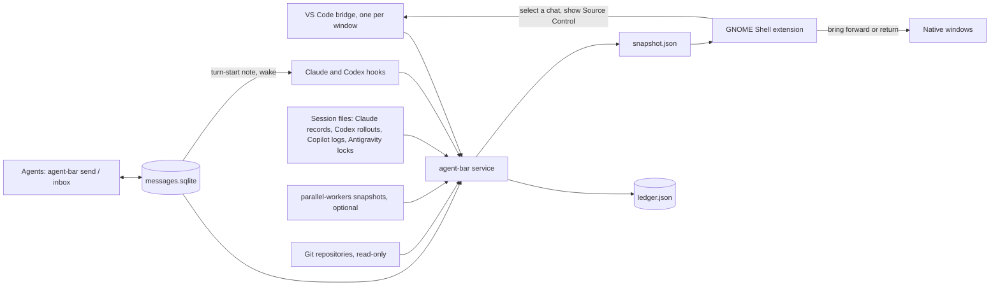

# Architecture

Agent Bar has four parts: a Python service and CLI (`agent_bar/`), provider hooks, a VS Code bridge and a menu-bar
front end for each platform (today, a GNOME Shell extension on Linux). They share state through owner-only files in
`~/.local/state/agent-bar`. The service, CLI, hooks and bridge are meant to be shared by every platform; the parts that
read Linux's process tables and X11 windows are the ones a macOS or Windows edition replaces.

## Service and CLI

`agent-bar serve` (the `agent-bar.service` user unit) collects every 3 s and writes `snapshot.json`, which the panel
reads asynchronously. It also answers a Unix-socket JSON API that the CLI uses. Provider identity, turn state, queue
state and unread reasons stay separate in the data.

- **VS Code:** each window's bridge publishes its folders, open tabs, provider versions and a heartbeat. Codex's
  per-window view-activity log establishes open sidebar conversations, and its custom-editor URIs identify editor
  ones; Claude's saved panel-session IDs are matched against live tab labels, with ambiguous matches rejected.
- **Terminals and apps** (`providers.py`): Claude Code CLI sessions from `~/.claude/sessions/<pid>.json`, checked
  against the process start time; Codex CLI and desktop-app threads from the rollout files a non-VS Code `codex`
  process holds open; Copilot CLI sessions from the `process-<ms>-<pid>.log` that names a live process's foreground
  session, then that session's `workspace.yaml` and `events.jsonl`; Antigravity conversations from the
  `presence/<id>.lock` files their IDE, App or CLI holds, with `conversation_summaries.db` for titles, folders and run
  status. Each gets a stand-in window naming the processes whose native window shows it.
- **Turns:** provider hooks write one small event file per lifecycle event; the collector also tails open Codex
  rollouts and Copilot event logs with bounded reads. For open Claude chats it tails the transcript for unfinished
  background work, a scheduled wake-up, and whether the latest prompt came from a person, so a reply to an automatic
  wake-up with work still pending holds as waiting instead of needing review.
- **Ledger** (`state.py`): per chat, its state, unread reasons and the acknowledgment cutoff; per folder name, the
  latest turn start; per queue, when it was first seen finished. A project's queue count includes running queues and
  those finished after its last turn; when all of them have finished, its most recently active open chat gets a
  "Queues finished" reason.
- **Inventory** (`inventory.py`): every saved Claude and Codex chat, rescanned daily at idle priority, reading only
  appended transcript data.
- **Git** (`git.py`): every 20 s, off the collection loop, the `git status` of each repository holding an open folder,
  with `GIT_OPTIONAL_LOCKS=0` so it never takes the index lock an agent's own git command needs. It never fetches.
- **Info** (`info.py`): read only when the panel's Info tab asks: skills, the usage limits Claude Code caches in
  `~/.claude.json` and Codex writes into its rollouts, hook health, and instruction files.

## Hooks

`python -m agent_bar.hook` is the metadata-only observer Claude Code and Codex run on lifecycle events. It records the
event kind, session, time and folder, never prompt or tool text, and never blocks a turn. Its only output is a note
about unread agent messages (`additionalContext` on `UserPromptSubmit`). For Claude, a second Stop hook,
`python -m agent_bar.hook wait`, runs in the background (`asyncRewake`, two-hour timeout); with waking on, it exits 2
once per new message, which Claude Code turns into a wake. `agent-bar install` adds both and removes hooks left by an
earlier installation's interpreter.

## Messages

`messages.py` keeps notes in `messages.sqlite`. The CLI writes and reads it directly, identifying the sender from
`CLAUDE_CODE_SESSION_ID` or `CODEX_THREAD_ID`. Sending needs an open Claude Code or Codex recipient and passes a
per-pair loop guard, reset by the sender's last human prompt or by the user, plus an hourly cap; refused sends are
kept so the panel can show what was held back. Files under `wake/` hold each recipient's newest unread id, the newest
it was woken or told about, and its one live waiter's pid. A chat in a turn gets new messages mid-turn only as the
user's setting allows.

## GNOME Shell extension

`agent_bar/data/gnome-extension` renders the snapshot in GNOME Shell 42 and runs the `agent-bar` CLI for actions.
Bringing a chat forward saves the window's place, maximizes it on the primary display and asks its VS Code bridge to
reveal the exact tab or sidebar; only a confirmed navigation acknowledges the chat. A second click while it has focus
returns the window. Menus are rebuilt after the click that asked for it finishes, and keyboard focus moves off any
widget before it is destroyed: GNOME Shell 42 crashed in `Main.pushModal` reading a freed key-focus actor.

The extension exports `io.github.nikvetr.AgentBar` at `/org/gnome/Shell/Extensions/AgentBar` on the session bus
(`Inspect`, `Show`, `Hide`, `Activate`), sharing the panel's navigation code, for tests and automation.

## VS Code bridge

`agent_bar/data/vscode-bridge` is a dependency-free extension running once per window. It publishes the window's
state, answers navigation and Source Control requests through per-window request and response files, and claims
`agent-bar resume` requests for its folder, opening the session through Claude's `claude-vscode.editor.open` command or
Codex's `openai-codex://route/local/<id>` editor.
