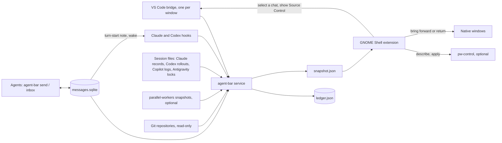

# Architecture

Agent Bar has four parts: a Python service and CLI (`agent_bar/`), provider hooks, a VS Code bridge and a menu-bar
front end for each platform (today, a GNOME Shell extension on Linux). They share state through owner-only files in
`~/.local/state/agent-bar`. The service, CLI, hooks and bridge are meant to be shared by every platform; the parts that
read Linux's process tables and X11 windows are the ones a macOS or Windows edition replaces.

## Service and CLI

`agent-bar serve` (the `agent-bar.service` user unit) collects every 3 s and writes `snapshot.json`, which the panel
reads asynchronously. It also answers a Unix-socket JSON API that the CLI uses. Provider identity, turn state, queue
state and unread reasons stay separate in the data.

- **VS Code:** each window's bridge publishes its folders, open tabs, provider versions and a heartbeat. Codex's
  per-window view-activity log establishes open sidebar conversations, and its custom-editor URIs identify editor
  ones. The collector saves those IDs per live bridge and reads the final events from a rotated log.
  If the original view event has rotated away, a turn submitted from that window can recover its conversation ID.
  For a recovered ID, or when several Codex IDs have no matching tab in one window, the bridge opens the requested ID in a Codex
  editor and verifies the active tab's URI. Claude's saved panel-session IDs are matched against live tab labels,
  with ambiguous matches rejected.
- **Terminals and apps** (`providers.py`): Claude Code CLI sessions from `~/.claude/sessions/<pid>.json`, checked
  against the process start time; Codex CLI and desktop-app threads from the rollout files a non-VS Code `codex`
  process holds open; Copilot CLI sessions from the `process-<ms>-<pid>.log` that names a live process's foreground
  session, then that session's `workspace.yaml` and `events.jsonl`; Antigravity conversations from the
  `presence/<id>.lock` files their IDE, App or CLI holds, with `conversation_summaries.db` for titles, folders and run
  status. Each gets a stand-in window naming the processes whose native window shows it.
- **Turns:** provider hooks write one small event file per lifecycle event; the collector also tails open Codex
  rollouts and Copilot event logs with bounded reads. For open Claude chats it tails the transcript for unfinished
  background work, a scheduled wake-up, and whether the latest prompt came from a person, so a reply to an automatic
  wake-up with work still pending holds as waiting instead of needing review, unless its turn read agent messages.
- **Ledger** (`state.py`): per chat, its state, unread reasons and the acknowledgment cutoff; per folder name, the
  latest turn start; per queue, when it was first seen finished. A project's queue count includes running queues and
  those that ended after its last turn (the monitor's end time, or when the tracker saw the end if sooner); when all
  of them have finished, its most recently active open chat gets a "Queues finished" reason. A finished queue the
  monitor reports active again with no new jobs done stays finished. Each hour the service forgets finished queues
  a week after they finished once no count includes them and the monitor no longer lists them, closed chats idle for
  30 days, and files left by closed windows. A turn a usage limit stopped (Claude's StopFailure with `rate_limit`, with the reset time
  from the transcript's closing API error; Codex's `task_complete` with `usage_limit_exceeded`) marks the chat
  `limited` until its next turn starts. For Codex, the collector pairs the stop with that thread's quota readings
  from the same turn. When only its five-hour window is exhausted, it saves the reset time. With automatic
  continuation enabled, the service queues a continuation by thread ID once the reset passes and the thread is
  open in VS Code. Manual and scheduled continuations share a durable delivery record. If delivery was interrupted
  with an unknown outcome, the manual Continue action can retry it.
- **Inventory** (`inventory.py`): every saved Claude and Codex chat, rescanned daily at idle priority, reading only
  appended transcript data. The same pass indexes direct message text in `history-search.sqlite` using SQLite FTS5.
  The search index and inventory track the file identity and byte offset. Replacing or truncating a transcript rebuilds
  its entries. Chats and History share a query and hit cache. Message searches run through the CLI after a short typing delay
  and return one excerpt per matching conversation. Expanding a hit queries that conversation for a bounded passage around the selected occurrence
  and nearby dialogue. The panel loads one passage at a time and keeps its position while the search is open.
- **Git** (`git.py`): every 20 s, off the collection loop, the `git status` of each repository holding an open folder,
  with `GIT_OPTIONAL_LOCKS=0` so it never takes the index lock an agent's own git command needs. It never fetches.
- **Usage** (`usage.py`): once a minute, off the collection loop, the usage limits Claude Code caches in
  `~/.claude.json` (its `limits`, including weekly limits scoped to a model, and those models' shares of the weekly
  limit) and the `rate_limits` Codex writes into its rollouts. Rollouts are read from a saved offset per file, so after
  the first read (a few seconds, the last 15 days) each pass reads only new lines. Readings go to
  `usage-history.json` when they change (a reset time drifting by seconds is the same window), kept 15 days. The
  summary in the snapshot gives each limit's pace (since the reading in force a day earlier, or since its window began
  empty), when that pace would use the rest, the share used by its reset, and for weekly limits the points used each
  local day, split into scoped models and the rest. `agent-bar usage` prints the same summary. With the panel's Read
  Claude limits setting on (off by default), each pass also reads `GET https://api.anthropic.com/api/oauth/usage`, the
  undocumented endpoint Claude Code's `/usage` reads, with Claude Code's OAuth access token, every 10 minutes, waiting
  up to an hour after failures. It never renews the token; an expired one waits for Claude Code. The answer has the
  same shape as Claude Code's cache, and the newer of the two readings is current.
- **Costs** (`costs.py`): with each usage pass, the token counts in Claude transcripts (every `.jsonl` under
  `~/.claude/projects`, subagents included) and Codex `token_count` events, read from saved offsets like the usage
  pass, priced with `data/prices.json` merged with `~/.config/agent-bar/prices.json`. A Claude reply written once per
  content block counts once (message and request ID). A Codex response counts when its thread's running total moves,
  using that response's own tokens, so repeated readings and continuation files add nothing. Totals go to
  `costs.json` per local day, provider and model (15 days) and per chat; a change to the effective prices counts
  everything again. The snapshot carries the summary and the open chats' totals.
- **Checklists** (`checklists.py`): every 30 s, the task checklists in the open projects' `tmp/agent/checklists/`,
  parsed only when a file's size or modification time changes, with the open chats seen editing each (`Background`
  notes Claude's Edit/Write/writing Bash calls, `Providers.events` Codex's apply_patch and shell calls, both from the
  transcript tails they already read). The full result goes to `checklists.json` only when it changes; the snapshot
  carries per-folder counts for the panel's row buttons.
- **Info** (`info.py`): read only when the panel's Info tab asks: skills, hook registrations, tracker health, and instruction files.
  The hook inventory reads Claude settings and enabled installed plugin definitions for the selected folder and requests
  Codex’s effective hook list and trust states for that folder over the local app-server connection. The CLI returns
  each handler’s declared action and its event, matcher, and condition together for each trigger. Reading Info never
  executes a registered handler.

The Queues tab reads prerequisite outcomes through `agent-bar queue-dependencies`. The service uses the collector’s
adaptive registrations and the scheduler’s retained registration index to find immutable batch declarations. It indexes the dependencies of all tracked queues by pool, queue ID,
and batch directory so a filtered queue can still show which other queues depend on it. For
queues in the selected list, it reads each prerequisite’s status and verification markers on the mounted share.
Reads run outside the collection loop, only on request, with a 30-second result cache.
The ledger retains declarations for tracked queues after scheduler retirement. Each snapshot numbers active queues
by launch time within their project. Dependency lookup and caching use monitor IDs so a change in display number
preserves the link to the original queue.

## Hooks

`python -m agent_bar.hook` is the metadata-only observer Claude Code and Codex run on lifecycle events. It records the
event kind, session, time and folder, never prompt or tool text, and never blocks a turn. Its only output is a note
about unread agent messages (`additionalContext` on `UserPromptSubmit`). For Claude, a second Stop hook,
`python -m agent_bar.hook wait`, runs in the background (`asyncRewake`, one-week timeout); with waking on, it exits 2
once per new message, which Claude Code turns into a wake. `agent-bar install` adds both and removes hooks left by an
earlier installation's interpreter. It also copies the skill in `agent_bar/data/skills` (how agents use
messages and tickets) into `~/.claude/skills` and `~/.agents/skills`, only where no skill of that name exists; a
copy it made holds a `.installed-by-agent-bar` file, and only such copies are updated or removed.

## Messages

`messages.py` keeps notes in `messages.sqlite`. The CLI writes and reads it directly, identifying the sender from
`CLAUDE_CODE_SESSION_ID` or `CODEX_THREAD_ID`. Sending needs an open Claude Code or Codex recipient and passes a
per-pair loop guard, reset by the sender's last human prompt or by the user, plus an hourly cap; refused sends are
kept so the panel can show what was held back. Files under `wake/` hold each recipient's newest unread id, the
newest it was woken or told about, and its one live waiter's pid. A chat in a turn gets new messages mid-turn only
as the user's setting allows. With waking on, `codex_wake.py` uses the Codex app-server queue API on send for VS Code
recipients. It adds one inbox notification, then moves its ID ahead of existing drafts using their current order.
If the queue changes during the reorder, it reads the IDs again and retries once. A per-chat lock serializes sends
and a `.queued` marker coalesces notifications until a turn starts. A busy chat with an empty queue receives a
`.deferred` marker so the service can queue its notification after the turn if messages are still unread.
If the queue API is unavailable, idle chats use the `codex queue` command and busy chats defer until turn end.
When a queued note's turn starts with nothing unread, the hook says the messages were already read; any
other turn start clears both markers, since that turn hears of unread messages itself. The snapshot's `messages.stranded` lists the open chats whose
unread messages wait for the user to start a turn: Codex chats with no note queued, and Claude chats no waiter will
wake (waking off, or idle with no live waiter left).

## Tickets

`tickets.py` keeps tickets in `tickets.sqlite`, written and read by the CLI directly; the panel runs the same CLI. The
author comes from `CLAUDE_CODE_SESSION_ID` or `CODEX_THREAD_ID` when set (so an agent cannot write as the user), else
the user. Each wait is resolved when the ticket is written and stored as data: a reset time from the snapshot's usage
summary, the ids of the project's outstanding queues from the ledger (by `project_names` of the ticket's folder), a
time, or another ticket's number. Readiness is computed on listing: times against now, queues against the ledger
(a forgotten queue finished long ago), tickets against those still open. The service puts the listing in the
snapshot, rereading it when the database or the queues change, and every 30 s for waits on time. Numbers are never
reused, so prompts and `ticket:` waits keep pointing at the same ticket; closed tickets are pruned after 30 days.
A ticket with `deliver_to` is sent rather than kept: the service's loop checks the listing each pass and, off the
loop, `tickets.deliver_due` sends each ready one with `messages.send` from its author, then closes it, or for a
`repeat` moves its date wait to the next occurrence counted from the first (`anchor`), skipping missed ones. A
failure is stored on the ticket (`delivery_error`, `tried_at`) and retried after 10 minutes. Only this path sends
as `user`: `send` refuses that sender otherwise, the user's messages skip the loop guard, and the turn-start note and
`inbox` call them the user's requests rather than information. Commands reserved for the user (writing a ticket as the
user, resetting the loop guard) also refuse when a `claude` or `codex` process is among their ancestors
(`state.agent_ancestor`), since an agent can unset its session variables but not its ancestry.

`ticket start` and `resume` share `bridge.in_folder`: it leaves a request under `resume/` and runs `code <folder>`,
which focuses the window open there or opens one; the first bridge on that folder takes the request and either
reopens a chat or runs `claude-vscode.editor.open` with no session and the prompt, which Claude Code puts in a new
chat's input box without sending it. A window whose bridge predates the feature (`resume`, `start` in its published
window file) must be reloaded first.

## GNOME Shell extension

The Cluster tab requests `agent-bar host-projects HOST` while a node's side dropdown is open.
The command reads the scheduler's last-known reservation table for that node on the locally mounted share,
matches queue IDs to projects in the collector snapshot and sums reserved CPU units and current sampled memory.
The report must match the current pool and host and have a recent sample.

`agent_bar/data/gnome-extension` renders the snapshot in GNOME Shell 42 and runs the `agent-bar` CLI for actions.
Bringing a chat forward saves the window's place, maximizes it on the primary display and asks its VS Code bridge to
reveal the exact tab or sidebar; only a confirmed navigation acknowledges the chat. A second click while it has focus
returns the window. Menus are rebuilt after the click that asked for it finishes, and keyboard focus moves off any
widget before it is destroyed: GNOME Shell 42 crashed in `Main.pushModal` reading a freed key-focus actor.

The top bar is one panel button holding parts (chat counts, limits, working and waiting, mail, queues), each with its
own hover highlight, beside a separate cluster indicator without a menu of its own; each opens the one dropdown on
its tab. While the dropdown is open, GNOME 42 routes every event through the menu's actor, where the panel's menu
manager closes the menu on any press outside it; the extension moves that handler behind its own, which turns a
press on another part into a tab switch and lets any other press close the menu as before. The side dropdown (scheduling, checklists, or projects on a node) is a child of the same menu, in a zero-size holder
with a fixed layout, positioned just past the menu's right edge: as a descendant of the grabbed actor it receives
input, and the manager does not count a press on it as outside the menu.

Continue, for chats a usage limit stopped, runs `agent-bar continue <key>`: the service queues the note for a Codex chat
with `codex queue`, or returns it for a Claude chat. The panel then brings the Claude chat forward with
`navigate --input`, and pastes the note at the end of the input box through a virtual keyboard: copy the draft and put
the cursor back at its end, then paste the note after a blank line. The keys reach whichever window has focus, so they
go only while the chat's window has it and no other input has come since. Otherwise the note stays on the clipboard;
the clipboard's earlier text is restored.

Scheduler controls in the Queues tab come from the scheduler's own control command (parallel-workers' `pw-control`,
protocol 1), which the panel runs directly; the service is not involved. `describe` lists the pool, hosts and queues
with their facts and typed control descriptors, read from the collector's `cluster-status.json`; it runs when the tab
opens and every 10 s while it shows, and the tab redraws only when controls or reachability change, keeping what was
typed. Queues join snapshot rows by `snapshot_id`. `apply` takes one change on stdin with `expect` set to the value
shown, so the scheduler refuses one made meanwhile, and answers in JSON either way. The panel checks only whole-number
bounds and required fields itself, and holds a control as applied until a description read after the change arrives.

The extension exports `io.github.nikvetr.AgentBar` at `/org/gnome/Shell/Extensions/AgentBar` on the session bus
(`Inspect`, `Show`, `Hide`, `Activate`, `Reload`), sharing the panel's navigation code, for tests and automation.
`agent-bar install` calls `Reload` after copying the extension: the running copy rereads the installed `extension.js`
and stylesheet into GNOME Shell 42, which otherwise keeps an extension's first code until the next login, and keeps
the running code if the new one fails to load or start.

## VS Code bridge

`agent_bar/data/vscode-bridge` is a dependency-free extension running once per window. It publishes the window's
state, answers navigation and Source Control requests through per-window request and response files (a navigation
with `input` also runs Claude's Focus Input, but only when no other Claude chat is on show, since that command focuses
every one on show), and claims
`agent-bar resume` requests for its folder, opening the session through Claude's `claude-vscode.editor.open` command or
Codex's `openai-codex://route/local/<id>` editor.
